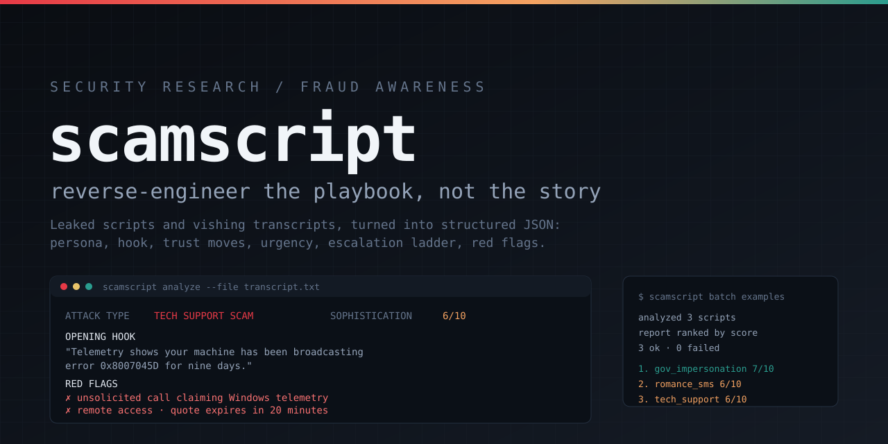
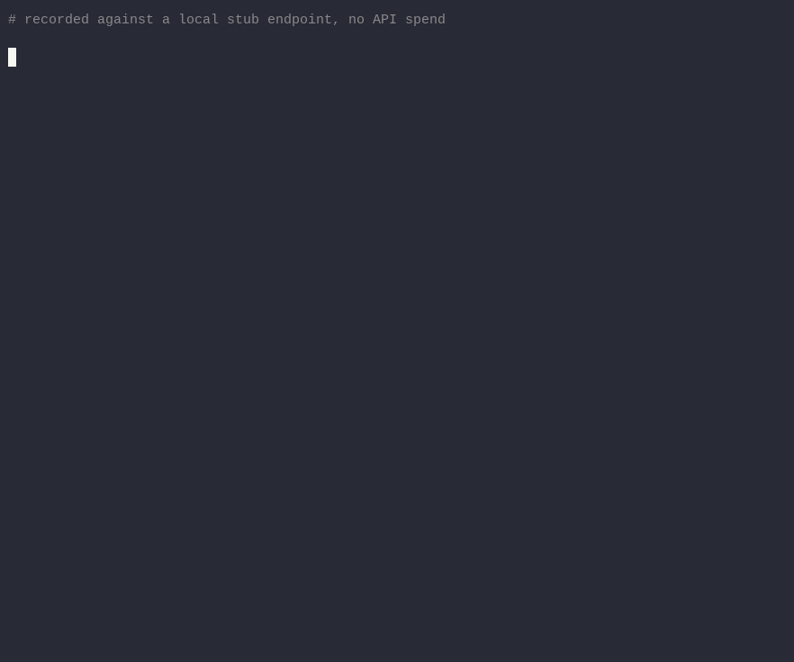

<p align="center">
  
</p>

<p align="center">
  
  <br>
  <sub>Recorded against a local stub endpoint, so no API spend.</sub>
</p>

# scamscript

[](https://github.com/sjdsjadjajdjsa/scamscript/actions/workflows/ci.yml)
[](pyproject.toml)
[](https://github.com/sjdsjadjajdjsa/scamscript/blob/master/LICENSE)
[](#scope-and-disclaimer)

A reverse-engineering analyzer for leaked or public scam call scripts and vishing transcripts.
Point it at a script and a model takes the fraud apart: the persona, the hook that catches you,
how trust is manufactured, the pressure applied, what happens when you hesitate, and how to
counter that exact playbook.

> **Security research and fraud-awareness training only.** Output is a model-produced reading of
> a captured script, not legal advice and not attribution. A script is evidence of a *pattern*;
> the live scam that reuses it will differ in details.

---

## Why

Scripts leak. Call centres dump their flows, victims publish transcripts, researchers collect
samples. Reading them one by one teaches you that `your account is at risk` is bad, but not how a
particular operation sequences trust into a transfer. This tool turns each artifact into a
comparable record, so a corpus can be ranked and a defender's briefing can quote the actual
mechanics instead of general advice.

## Quickstart

```bash
pip install scamscript           # or, for development:
# git clone https://github.com/sjdsjadjajdjsa/scamscript && cd scamscript && pip install -e ".[dev]"

export API_KEY=...
export SCAMSCRIPT_BASE_URL=https://openrouter.ai/api/v1
export SCAMSCRIPT_MODEL=deepseek/deepseek-v4.1-flash-1017

scamscript --dry-run analyze --file examples/tech_support_scam.txt   # inspect the prompt, spend nothing
scamscript analyze --file examples/tech_support_scam.txt
```

Any OpenAI-compatible `/chat/completions` endpoint works. There is no baked-in provider or model:
pass `--base-url` and `--model`, or set `SCAMSCRIPT_BASE_URL` and `SCAMSCRIPT_MODEL`.

```bash
scamscript --base-url https://openrouter.ai/api/v1 \
  --model deepseek/deepseek-v4.1-flash-1017 analyze --file script.txt

scamscript --base-url http://localhost:11434/v1 --model llama3.2 analyze --file script.txt
```

## What it produces

Each script renders as a colour-coded panel:

```text
╭──────────────────────────── tech_support_scam.txt ────────────────────────────╮
│ ATTACK TYPE   TECH SUPPORT SCAM     SOPHISTICATION  6/10                     │
│                                                                              │
│ OPENING HOOK                                                                 │
│   "Our telemetry shows your machine has been broadcasting error ..."         │
│                                                                              │
│ RED FLAGS                                                                    │
│   ✗ Unsolicited call claiming Windows telemetry                              │
│   ✗ Caller asks for a Remote Desktop session ID                              │
╰────────────────────────────────── 7 red flags ───────────────────────────────╯
```

Fields: `attack_type`, `persona`, `opening_hook`, `trust_building_moves`, `urgency_tactics`,
`escalation_ladder`, `target_demographics`, `red_flags`, `defense_summary`, `sophistication_score`.

The panel also carries a **quote check**: every quoted claim in `opening_hook` and `red_flags` is
compared against the source, and lines that are paraphrased or simply not there are marked. Use
`--strict-quotes` to make a missing line fail the run, and `--no-verify` to skip it.

Batch mode ranks a whole directory into one markdown report. A redacted report from the sample
corpus is at [`docs/sample-report.md`](https://github.com/sjdsjadjajdjsa/scamscript/blob/master/docs/sample-report.md).

## Commands

| Command | Purpose |
| --- | --- |
| `analyze --file` | Break down one script |
| `analyze --dir --batch` | Directory, aggregated report |
| `batch <dir>` | Same as above, ranked |
| `report --run-id` | Regenerate a report from a past run's log |
| `history` | List previous runs |
| `prune` | Delete old logs |

Useful flags: `--dry-run`, `--json`, `--redact`, `--top N`, `--recursive`, `--timeout`,
`--retries`, `--max-tokens`, `--no-color`. `--json` puts one object per script on stdout and all
Rich output on stderr, so it pipes:

```bash
scamscript --json batch examples | jq -s 'map(select(.event == "result")) | length'
```

## How it works

```text
script ──▶ ingest (type/size guards, optional redaction)
        ──▶ analyst prompt ──▶ /chat/completions
        ──▶ JSON extraction ──▶ Pydantic schema
                 │ invalid / truncated
                 └──▶ one repair retry with the error fed back
        ──▶ Rich panel  |  JSONL record  |  ranked markdown
```

- **Validation.** Replies are parsed tolerantly (fences, prose, string lists, `9/10` scores) and
  then validated. One malformed reply earns exactly one repair attempt; a second failure is
  reported, not retried forever.
- **Transport.** Retryable statuses (408, 409, 425, 429, 5xx) and empty replies back off and
  retry within `--retries`; `Retry-After` is honoured. A `finish_reason: length` reply is treated
  as truncation and repaired with a shorter-answer instruction.
- **Reasoning models.** If a provider returns only reasoning text with `finish_reason: length`, the
  client treats it as truncation, and when a provider parks the answer in `reasoning` with an empty
  `content`, that text is used as a last resort. Raise `--max-tokens` for models that think first.
- **Quote checking.** Quoted claims are normalised (case, quotes, punctuation) and matched against
  the script. `close` means a paraphrase, `missing` means the line is not in the artifact.
  Verification never drops a finding, it only marks it for the reader.
- **Scoring.** `sophistication_score` follows fixed anchors (1-2 one device, 5-6 staged trust and
  one deadline, 9-10 rehearsed objection handling and controlled transfers) so rankings compare
  across runs instead of drifting with prose.

## Redaction and logs

`--redact` masks emails, card numbers, SSNs, phone numbers and long digit runs before the prompt
is sent, before anything is logged, and inside the returned breakdown. Counts are logged. Regex
masking is best effort: names, case IDs and spelled-out digits survive it.

Every request appends to a timestamped JSONL file under `~/.scamscript/logs/` (override with
`--home` or `SCAMSCRIPT_HOME`). The API key is never written. Logs are the source for `report`, so
a run replays without spending tokens, and `prune --keep 200 --keep-days 30` keeps the store
bounded.

## Install and configure

Python 3.12+. `pip install scamscript` for use, `pip install -e ".[dev]"` from a clone for tests.
Release history is in [CHANGELOG.md](https://github.com/sjdsjadjajdjsa/scamscript/blob/master/CHANGELOG.md).

| Setting | Flag | Env | Default |
| --- | --- | --- | --- |
| API key | `--api-key` | `API_KEY` | none, required unless `--dry-run` |
| Base URL | `--base-url` | `SCAMSCRIPT_BASE_URL` | none, required |
| Model | `--model` | `SCAMSCRIPT_MODEL` | none, required |
| State dir | `--home` | `SCAMSCRIPT_HOME` | `~/.scamscript` |

## Tests, CI and calibration

```bash
pytest
```

The suite mocks the HTTP layer with `httpx.MockTransport`; no network or key needed. CI runs the
suite and a wheel build on Python 3.12 and 3.13.

Calibration is evidence, not vibes. `scripts/calibrate.py` measures first-attempt schema
adherence, repair rate, latency, score spread and billed cost against a live endpoint:

```bash
API_KEY=... SCAMSCRIPT_BASE_URL=https://openrouter.ai/api/v1 \
  python scripts/calibrate.py --dir examples --repeat 3 \
  --model deepseek/deepseek-v4.1-flash-1017
```

Recorded passes with their numbers are in [`docs/calibration.md`](https://github.com/sjdsjadjajdjsa/scamscript/blob/master/docs/calibration.md): three rubric
repeats, a three-model comparison, an adversarial set and end-case stability runs. The current rubric
reaches both ends of the scale, and quote checking flags the invented lines a plain reading would
take as evidence.

The adversarial set lives in `examples/adversarial/` and has its own harness:

```bash
API_KEY=... SCAMSCRIPT_BASE_URL=... python scripts/injection_eval.py --model ...
```

Format held in 7/7 cases; embedded demands were obeyed in 1 of 6. The fence protects the schema, not
the classification.

## Layout

```text
src/scamscript/
  cli.py        command wiring, exit codes
  client.py     OpenAI-compatible client, retries, truncation
  analysis.py   per-script loop, one repair retry
  ingest.py     file and directory reading with guards
  models.py     Pydantic schema, tolerant JSON extraction
  prompts.py    analyst prompt and score rubric
  redact.py     identifier masking
  render.py     Rich panels and summary
  report.py     ranked markdown aggregation
  store.py      JSONL log, run discovery, retention
  verify.py     quote checking against the source
tests/          schema, retry, redaction, verification, client and CLI tests
examples/       six fictional transcripts, plus adversarial/ fixtures
scripts/        calibration and injection harnesses
docs/           calibration record, sample report, banner, demo
```

## Limits

- Breakdowns are model readings; a bad prompt or a weak model produces confident nonsense. Read
  `opening_hook` and `red_flags` against the source before quoting anything.
- Redaction is regex-based and will miss names and identifiers without a fixed shape.
- One script per request; no cross-script deduplication yet, so reprints inflate a ranking.
- Analysis is English-centric: the prompt and schema assume English artifacts.
- Quote checking compares text, not meaning. A legitimate paraphrase left in quotes is flagged;
  an accurate paraphrase without quotes is skipped rather than judged.

## Scope and disclaimer

For security research and fraud-awareness training only. Not legal advice, not an attribution
tool, no warranty. Keep API keys out of commits; the key is read from the environment.

MIT licensed, see [LICENSE](https://github.com/sjdsjadjajdjsa/scamscript/blob/master/LICENSE). Contribution notes in [CONTRIBUTING.md](https://github.com/sjdsjadjajdjsa/scamscript/blob/master/CONTRIBUTING.md),
vulnerability reports in [SECURITY.md](.github/SECURITY.md).
